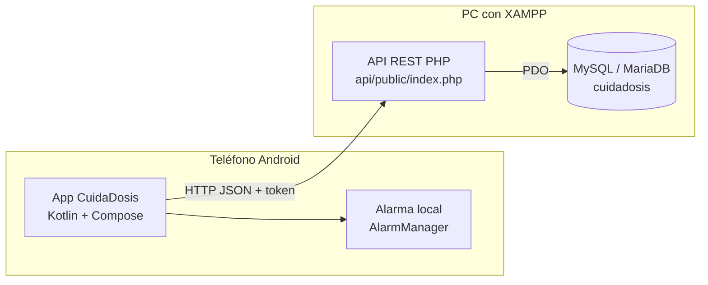
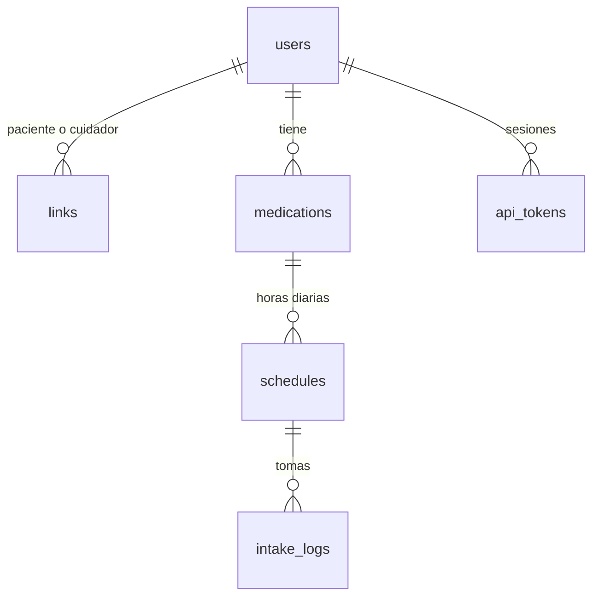

# CuidaDosis

Aplicación móvil para recordar y registrar la toma de medicamentos, con seguimiento por parte de un cuidador. Una sola app sirve para ambos roles.

**Problema que atiende:** las personas con tratamientos diarios olvidan tomas o no recuerdan si ya las tomaron, y quienes las cuidan no tienen una forma sencilla de saberlo. CuidaDosis avisa al paciente 5 minutos antes de cada toma, le permite marcarla como "Tomado" y deja que un cuidador vinculado consulte el estado del día de cada uno de sus pacientes.

> Prototipo académico. CuidaDosis no recomienda dosis ni sustituye al médico.

## Equipo

- Omar Eduardo Betanzos Martínez
- José Eduardo Ríos Mendoza
- Alfonso Rosas Escobedo

**Docente:** José Alejandro Concha Uicab
**Contexto:** Seminario de Análisis y Diseño de Sistemas

## Alcance

### Funciones del alcance mínimo
1. Registro e inicio de sesión con roles: paciente y cuidador.
2. Vinculación entre paciente y cuidador mediante un código de invitación; cualquiera de los dos puede desvincularse.
3. Alta de medicamentos con horario diario.
4. Aviso 5 minutos antes de cada toma (alarma local en Android).
5. Botón "Tomado" y vista de estado de las tomas para el cuidador (puede seguir a varios pacientes).

### Fuera de alcance
- Notificaciones push.
- Reportes.
- Varios cuidadores activos por paciente.
- Recomendaciones de dosis.

### Limitaciones
- El botón "Tomado" registra un clic del usuario; no comprueba que el medicamento realmente se haya ingerido.
- El sistema no recomienda dosis ni sustituye al médico. El nombre y la dosis son texto libre que escribe el usuario y la app no los interpreta.
- El aviso depende de la alarma local del teléfono; las restricciones de ahorro de energía de Android (Doze) pueden afectarlo.
- Es un prototipo para entorno local; no está preparado para producción.

## Arquitectura general

- **App Android:** una sola app con las pantallas del paciente o del cuidador según el rol de la cuenta. Programa las alarmas locales y consume la API.
- **API REST en PHP:** recibe peticiones JSON, autentica con token y aplica las reglas de acceso por rol.
- **Base de datos MySQL:** usuarios, vínculos, medicamentos, horarios, registro de tomas y tokens.



## Estructura del repositorio

```
CuidaDosis/
  AGENTS.md     Reglas y convenciones para asistentes de IA
  CLAUDE.md     Notas específicas de Claude Code
  README.md     Este archivo
  .htaccess     Niega el acceso web a todo el repo
  android/      Proyecto de Android Studio
  api/          Backend PHP (solo api/public/ es accesible por web)
  bd/           Scripts SQL (schema.sql y seed.sql)
  docs/         Documentación técnica (docs/api.md)
```

## Tecnologías y versiones

| Parte | Tecnología | Versión |
|---|---|---|
| Servidor local | XAMPP: Apache | 2.4.58 |
| Backend | PHP | 8.2.12 |
| Base de datos | MariaDB (incluida en XAMPP, compatible con MySQL) | 10.4.32 |
| App | Kotlin | 2.2.10 |
| App | Jetpack Compose (BOM) | 2026.02.01 |
| App | Android Gradle Plugin / Gradle | 9.4.1 / 9.6.0 |
| App | compileSdk / targetSdk / minSdk | 37 / 37 / 26 (Android 8.0) |

## Cómo levantar el entorno local

### 1. XAMPP
1. Instala XAMPP y clona el repo en `C:\xampp\htdocs\CuidaDosis`.
2. En el panel de XAMPP inicia **Apache** y **MySQL**.

> htdocs es público. El archivo `.htaccess` de la raíz bloquea todo el repo y solo `api/public/` queda accesible. No lo borres.

### 2. Base de datos
```
C:\xampp\mysql\bin\mysql.exe -u <usuario> -p --default-character-set=utf8mb4 < bd\schema.sql
C:\xampp\mysql\bin\mysql.exe -u <usuario> -p --default-character-set=utf8mb4 cuidadosis < bd\seed.sql
```
También puedes importar ambos archivos desde phpMyAdmin (primero `schema.sql`, luego `seed.sql`).

> Volver a ejecutar `schema.sql` borra y recrea las tablas.

**Usuarios sintéticos del seed** (contraseña de prueba para todos: `Sintetico2026`):

| Correo | Rol | Situación |
|---|---|---|
| paciente1@ejemplo.test | Paciente | Vinculado con cuidador1; tiene medicamentos y tomas de hoy |
| paciente2@ejemplo.test | Paciente | Tiene un código de invitación pendiente: `SINT0002` |
| paciente3@ejemplo.test | Paciente | Vinculado con cuidador1; un medicamento a las 12:00 |
| cuidador1@ejemplo.test | Cuidador | Vinculado con paciente1 y paciente3 (varios pacientes) |
| cuidador2@ejemplo.test | Cuidador | Sin vincular; sirve para probar el código `SINT0002` |

### Modelo de datos



- Un paciente tiene como máximo un cuidador activo; un cuidador puede tener varios pacientes.
- Paciente o cuidador pueden desvincularse; el vínculo queda como `revoked` (no se borra) y el paciente puede invitar a otro cuidador.
- El código de invitación caduca a las 48 horas y es de un solo uso.
- Un medicamento puede tener varias horas diarias.
- Las tomas del día se crean como pendientes cuando se consulta el día.
- Medicamentos y horarios se desactivan en lugar de borrarse, para conservar el historial.

### 3. Configurar el .env
1. Copia `api/.env.example` como `api/.env`.
2. Llena los datos de conexión de tu MySQL local.
3. `api/.env` está en `.gitignore`: nunca lo subas al repo.

### 4. Ejecutar la app
1. Abre la carpeta `android/` en Android Studio y espera la sincronización de Gradle.
2. Configura la URL base de la API:
   - **Emulador:** `http://10.0.2.2/CuidaDosis/api/public/`
   - **Teléfono físico:** conecta el teléfono a la misma red Wi-Fi que la PC y usa `http://<IP de la PC>/CuidaDosis/api/public/`. Puede ser necesario permitir Apache en el firewall de Windows.
3. Ejecuta la app con el botón Run, o compila desde terminal con `gradlew.bat assembleDebug` dentro de `android/`.

## Cómo probar la API

Comprobación rápida (Apache encendido):
```
curl -i http://localhost/CuidaDosis/api/public/
```
Debe responder con `"status":"ok"`. La lista de endpoints, el formato de errores y ejemplos curl con los usuarios sintéticos están en [docs/api.md](docs/api.md).

## Estado del proyecto

| Fase | Descripción | Estado |
|---|---|---|
| 0 | Documentación base, .gitignore, .env.example y bloqueo web | Hecho |
| 1 | Base de datos: esquema y datos sintéticos | Hecho |
| 2 | API PHP y docs/api.md | Hecho |
| 3 | App Android v0.1: registro, login, lista y alta de medicamentos | Pendiente |
| 4 | Alarmas locales | Pendiente |

Funciones del alcance mínimo (se marcan cuando funcionan de punta a punta en la app):
- [ ] Registro e inicio de sesión con roles (API lista)
- [ ] Vinculación con código de invitación (API lista)
- [ ] Alta de medicamentos con horario diario (API lista)
- [ ] Aviso 5 minutos antes de la toma
- [ ] Botón "Tomado" y vista de estado para el cuidador (API lista)

## Aviso de datos

Todos los datos del repositorio son **sintéticos** y creados solo para pruebas (nombres marcados con "SINTETICO" y correos `@ejemplo.test`). No se usan ni se deben cargar datos reales de salud ni de personas.

## Cómo contribuir

1. **Ramas:** parte de `main` y crea una rama por tema, por ejemplo `feature/api-login` o `fix/alarma-hora`.
2. **Commits:** formato Conventional Commits, con tipo en inglés y descripción en español:
   - `feat(api): agrega endpoint de login`
   - `fix(android): corrige formato de hora`
   - `docs: actualiza estado del proyecto`
3. **Revisión:** abre un Pull Request hacia `main`; al menos otro integrante del equipo lo revisa antes de fusionarlo.
4. Antes de subir cambios, revisa que no incluyas credenciales, `.env` ni datos reales.
5. Las reglas completas están en [AGENTS.md](AGENTS.md).
