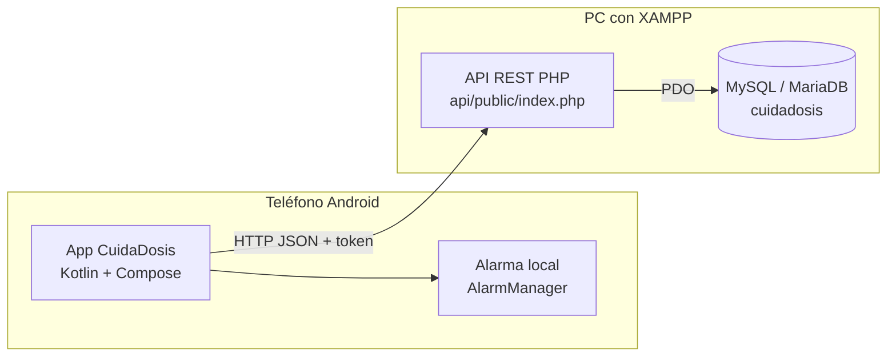
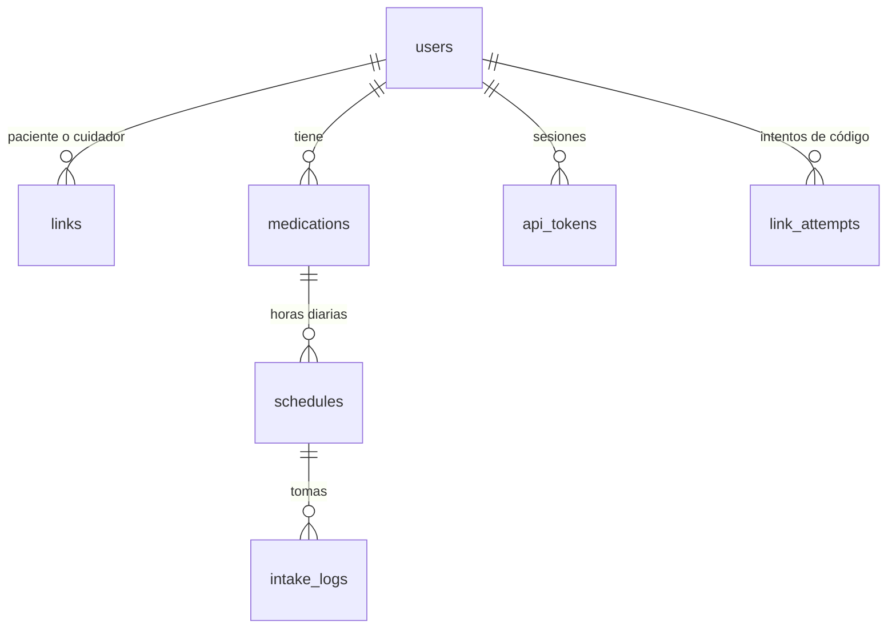

# CuidaDosis

Aplicación móvil para recordar y registrar la toma de medicamentos, con seguimiento por parte de un cuidador. Una sola app sirve para ambos roles.

**Problema que atiende:** las personas con tratamientos diarios olvidan tomas o no recuerdan si ya las tomaron, y quienes las cuidan no tienen una forma sencilla de saberlo. CuidaDosis avisa al paciente antes de cada toma (5 o 10 minutos, a su elección) y otra vez a la hora si sigue pendiente, le permite confirmarla con un toque aun sin internet y deja que un cuidador vinculado consulte el estado del día de cada uno de sus pacientes y reciba una alarma si una toma queda sin confirmar.

> Prototipo académico. CuidaDosis no recomienda dosis ni sustituye al médico.

## Equipo

- Omar Eduardo Betanzos Martínez
- José Eduardo Ríos Mendoza
- Alfonso Rosas Escobedo

**Docente:** José Alejandro Concha Uicab
**Contexto:** Seminario de Análisis y Diseño de Sistemas

## Alcance

El diseño objetivo es el de P2 v1.1 y P3 v1.0 (`docs/p2`, `docs/p3`, `docs/adr`). La Fase 6 alinea el prototipo con él.

### Dentro del prototipo: RF-01 a RF-16 y RF-18
1. Registro e inicio de sesión con roles: paciente y cuidador (RF-01, RF-02).
2. Alta, edición y desactivación de medicamentos con varias horas diarias (RF-03, RF-04).
3. Aviso local L minutos antes de cada toma (L = 5 o 10, por defecto 5, ajuste del teléfono), segundo aviso a la hora si sigue pendiente y posponer 5 o 10 min (RF-05, RF-06, RF-16).
4. Botón "Tomado" con un toque, sin diálogo. El estado se llama "Confirmada por el paciente" (RF-07).
5. Vinculación con código de 8 caracteres que dura 10 min; el paciente acepta o rechaza la solicitud; 5 intentos fallidos en 10 min bloquean al cuidador. Cualquiera de los dos puede desvincularse (RF-08, RF-09).
6. Vista del cuidador con tres etiquetas (Pendiente, Confirmada por el paciente, Sin confirmar a los 30 min), última sincronización del paciente y dosis oculta salvo autorización (RF-10 a RF-12).
7. Modo sin red: el paciente confirma sin conexión y la app envía las confirmaciones al volver la red, sin duplicados (RF-13).
8. Advertencias de permisos de notificaciones, alarmas exactas y ahorro de batería (RF-14).
9. Historial de 7 días en la API (RF-15, mínimo: sin pantalla en la app).
10. Alarma local del cuidador a T + 30 min si la toma sigue sin confirmar (RF-18).

### Fuera de alcance
- RF-17: notificación push al cuidador (queda como Futuro).
- Reportes.
- Varios cuidadores activos por paciente.
- Recomendaciones de dosis.

### Limitaciones
- "Confirmada por el paciente" registra un toque del usuario; no comprueba que el medicamento realmente se haya ingerido.
- El sistema no recomienda dosis ni sustituye al médico. El nombre y la dosis son texto libre que escribe el usuario y la app no los interpreta.
- El aviso es una alarma local del teléfono: sale aunque no haya red, pero no avisa si las notificaciones están desactivadas, y algunos fabricantes con ahorro de energía agresivo pueden retrasarlo. Las horas son de México (`America/Mexico_City`) aunque el teléfono esté en otra zona.
- Es un prototipo para entorno local; no está preparado para producción.

## Arquitectura general

- **App Android:** una sola app con las pantallas del paciente o del cuidador según el rol de la cuenta. Programa las alarmas locales y consume la API.
- **API REST en PHP:** recibe peticiones JSON, autentica con token y aplica las reglas de acceso por rol.
- **Base de datos MySQL:** usuarios, vínculos, medicamentos, horarios, registro de tomas y tokens.



## Estructura del repositorio

```
CuidaDosis/
  AGENTS.md     Reglas y convenciones para asistentes de IA
  CLAUDE.md     Notas específicas de Claude Code
  README.md     Este archivo
  .htaccess     Niega el acceso web a todo el repo
  android/      Proyecto de Android Studio
  api/          Backend PHP (solo api/public/ es accesible por web); api/tests/ tiene las pruebas automáticas
  bd/           Scripts SQL (schema.sql y seed.sql)
  docs/         Documentación técnica: api.md, decisiones de las fases 4 a 6, diseño P2/P3, ADR y evidencias
```

## Tecnologías y versiones

| Parte | Tecnología | Versión |
|---|---|---|
| Servidor local | XAMPP: Apache | 2.4.58 |
| Backend | PHP | 8.2.12 |
| Base de datos | MariaDB (incluida en XAMPP, compatible con MySQL) | 10.4.32 |
| App | Kotlin | 2.2.10 |
| App | Jetpack Compose (BOM) | 2026.02.01 |
| App | Android Gradle Plugin / Gradle | 9.4.1 / 9.6.0 |
| App | compileSdk / targetSdk / minSdk | 37 / 37 / 26 (Android 8.0) |

## Cómo levantar el entorno local

### 1. XAMPP
1. Instala XAMPP y clona el repo en `C:\xampp\htdocs\CuidaDosis`.
2. En el panel de XAMPP inicia **Apache** y **MySQL**.

> htdocs es público. El archivo `.htaccess` de la raíz bloquea todo el repo y solo `api/public/` queda accesible. No lo borres.

### 2. Base de datos
```
C:\xampp\mysql\bin\mysql.exe -u <usuario> -p --default-character-set=utf8mb4 < bd\schema.sql
C:\xampp\mysql\bin\mysql.exe -u <usuario> -p --default-character-set=utf8mb4 cuidadosis < bd\seed.sql
```
También puedes importar ambos archivos desde phpMyAdmin (primero `schema.sql`, luego `seed.sql`).

> Volver a ejecutar `schema.sql` borra y recrea las tablas.

**Usuarios sintéticos del seed** (contraseña de prueba para todos: `Sintetico2026`):

| Correo | Rol | Situación |
|---|---|---|
| paciente1@ejemplo.test | Paciente | Vinculado con cuidador1 (no comparte la dosis); tomas de hoy y de ayer |
| paciente2@ejemplo.test | Paciente | Código pendiente `SINT0002` (vence 10 min después de cargar el seed) |
| paciente3@ejemplo.test | Paciente | Vinculado con cuidador1 (sí comparte la dosis); un medicamento a las 12:00 |
| cuidador1@ejemplo.test | Cuidador | Vinculado con paciente1 y paciente3 (varios pacientes) |
| cuidador2@ejemplo.test | Cuidador | Sin vincular; sirve para probar el código `SINT0002` |

### Modelo de datos



- Un paciente tiene como máximo un cuidador activo; un cuidador puede tener varios pacientes.
- Paciente o cuidador pueden desvincularse; el vínculo queda como `revoked` (no se borra) y el paciente puede invitar a otro cuidador.
- El código de invitación caduca a los 10 minutos y es de un solo uso. Al usarlo, el vínculo queda en `awaiting_acceptance` hasta que el paciente lo acepta.
- Cada confirmación lleva un `client_uuid` único generado en el teléfono; reenviarla no la duplica.
- "Sin confirmar" se calcula (pendiente y más de 30 min después de la hora); no se guarda.
- La dosis solo se envía al cuidador si `links.share_dose = 1` (por defecto 0).
- Un medicamento puede tener varias horas diarias.
- Las tomas del día se crean como pendientes cuando se consulta el día.
- Medicamentos y horarios se desactivan en lugar de borrarse, para conservar el historial.

### 3. Configurar el .env
1. Copia `api/.env.example` como `api/.env`.
2. Llena los datos de conexión de tu MySQL local.
3. `api/.env` está en `.gitignore`: nunca lo subas al repo.

### 4. Ejecutar la app
1. Abre la carpeta `android/` en Android Studio y espera la sincronización de Gradle.
2. URL base de la API:
   - **Emulador:** `http://10.0.2.2/CuidaDosis/api/public/` (es el valor por defecto).
   - **Teléfono físico:** conecta el teléfono a la misma red Wi-Fi que la PC y usa `http://<IP de la PC>/CuidaDosis/api/public/`. Puede ser necesario permitir Apache en el firewall de Windows.
   - Para cambiar el valor por defecto al compilar, agrega `api.baseUrl=<URL>` a `android/local.properties` (no se versiona).
   - Sin recompilar: en la pantalla de login toca **Servidor**, escribe la URL, usa **Probar conexión** y **Guardar**.
3. Ejecuta la app con el botón Run, o compila desde terminal con `gradlew.bat assembleDebug` dentro de `android/`.
4. En Android 17 o superior la app pide el permiso de **dispositivos cercanos / red local** (`ACCESS_LOCAL_NETWORK`). Hay que aceptarlo: sin él Android bloquea la conexión a la PC con XAMPP (10.0.2.2 o la IP local).
5. Para los avisos, paciente y cuidador deben aceptar el permiso de **notificaciones** (Android 13 o superior). La alarma exacta usa `USE_EXACT_ALARM`, que Android concede al instalar. Si falta algún permiso o el ahorro de batería puede afectar los avisos, la app lo indica con una tarjeta.
6. El tráfico HTTP sin cifrar solo se permite en la versión debug. La versión release exige HTTPS.

> Si `gradlew.bat` falla con `jlink executable ... does not exist`, Gradle eligió una JRE incompleta (por ejemplo, la de una extensión de VS Code). Usa el JDK de Android Studio:
> ```
> set JAVA_HOME=C:\Program Files\Android\Android Studio\jbr
> gradlew.bat assembleDebug "-Dorg.gradle.java.installations.auto-detect=false" "-Dorg.gradle.java.installations.paths=C:\Program Files\Android\Android Studio\jbr"
> ```

**Qué hace la app hoy (Fase 6):**
- **Todos:** registro con rol (paciente o cuidador), inicio y cierre de sesión.
- **Paciente**, en tres pestañas más "Ajustes":
  - **Hoy:** tomas del día con el botón "Tomado" (un toque). Funciona sin red: la confirmación se guarda cifrada en el teléfono y se envía sola al volver la conexión. Muestra la última sincronización y avisa si no hay conexión.
  - **Medicamentos:** lista, alta, edición y desactivación, con varias horas diarias (requiere conexión).
  - **Cuidador:** generar el código (10 min), aceptar o rechazar la solicitud del cuidador, desvincularlo.
  - **Ajustes:** anticipación del aviso (5 o 10 min) y estado de los permisos.
  - **Avisos:** a T menos L y a la hora T si sigue pendiente, con botones "Posponer 5 min" y "Posponer 10 min". No suenan si la toma ya está confirmada. Se reprograman al reiniciar el teléfono.
- **Cuidador:**
  - Lista de pacientes con el resumen de hoy, "Sin confirmar" y la última sincronización; sección "Esperando aceptación".
  - **Vincular paciente** con el código, con mensajes claros si el código venció o hubo demasiados intentos.
  - Detalle de solo lectura con las tres etiquetas; la dosis solo si el paciente la comparte.
  - Alarma local a los 30 min de cada toma pendiente que, al sonar, revisa el estado y solo avisa si sigue sin confirmar.

Las decisiones están en [docs/decisiones-fase-4.md](docs/decisiones-fase-4.md), [docs/decisiones-fase-5.md](docs/decisiones-fase-5.md) y [docs/decisiones-fase-6.md](docs/decisiones-fase-6.md). Lo pendiente, en [docs/PENDIENTES_FASE6.md](docs/PENDIENTES_FASE6.md).

## Cómo probar la API

Comprobación rápida (Apache encendido):
```
curl -i http://localhost/CuidaDosis/api/public/
```
Debe responder con `"status":"ok"`. La lista de endpoints, el formato de errores y ejemplos curl con los usuarios sintéticos están en [docs/api.md](docs/api.md).

Pruebas automáticas de la API (Apache y MySQL encendidos; crean y borran sus propios usuarios sintéticos):
```
C:\xampp\php\php.exe api\tests\run_api_tests.php
```
Imprime cada caso con OK o FALLO y guarda el log en `docs/evidencias/p4/api-AAAAMMDD-HHMM.log`.

Pruebas unitarias de la app (dentro de `android/`): `gradlew.bat testDebugUnitTest`.

## Estado del proyecto

| Fase | Descripción | Estado |
|---|---|---|
| 0 | Documentación base, .gitignore, .env.example y bloqueo web | Hecho |
| 1 | Base de datos: esquema y datos sintéticos | Hecho |
| 2 | API PHP y docs/api.md | Hecho |
| 3 | App Android base: registro, login por rol y gestión de medicamentos | Hecho |
| 4 | App: tomas de hoy con "Tomado", vinculación y vista del cuidador | Hecho |
| 5 | Alarmas locales: aviso 5 minutos antes de cada toma | Hecho |
| 6 | Alineación con P2 v1.1 y P3: BD v2, vínculo con aceptación, sincronización sin red, avisos T menos L y T, alarma del cuidador | Hecho (pruebas en teléfono físico pendientes) |

Las funciones de las fases 0 a 5 funcionan de punta a punta. El detalle por requisito de la Fase 6 está en `RESUMEN_FASE6.md`.

## Aviso de datos

Todos los datos del repositorio son **sintéticos** y creados solo para pruebas (nombres marcados con "SINTETICO" y correos `@ejemplo.test`). No se usan ni se deben cargar datos reales de salud ni de personas.

## Cómo contribuir

1. **Ramas:** parte de `main` y crea una rama por tema, por ejemplo `feature/api-login` o `fix/alarma-hora`.
2. **Commits:** formato Conventional Commits, con tipo en inglés y descripción en español:
   - `feat(api): agrega endpoint de login`
   - `fix(android): corrige formato de hora`
   - `docs: actualiza estado del proyecto`
3. **Revisión:** abre un Pull Request hacia `main`; al menos otro integrante del equipo lo revisa antes de fusionarlo.
4. Antes de subir cambios, revisa que no incluyas credenciales, `.env` ni datos reales.
5. Las reglas completas están en [AGENTS.md](AGENTS.md).
